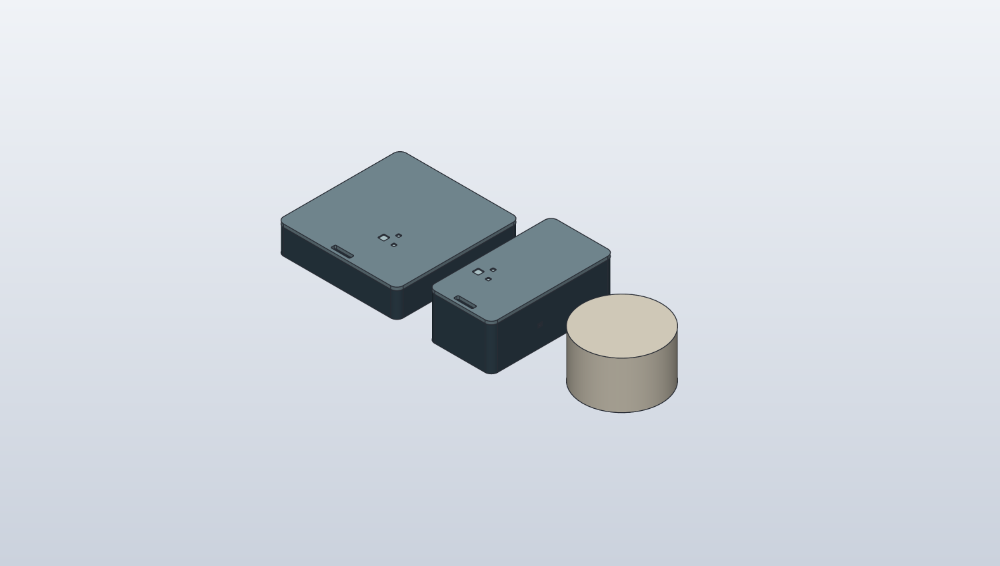
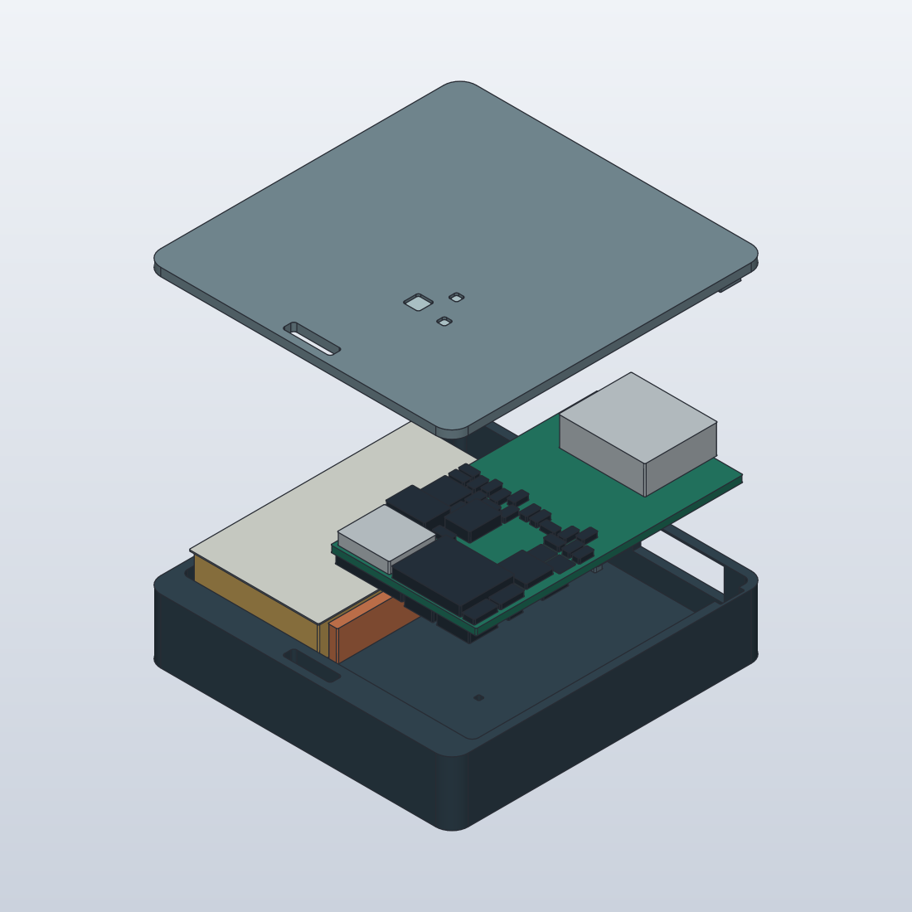
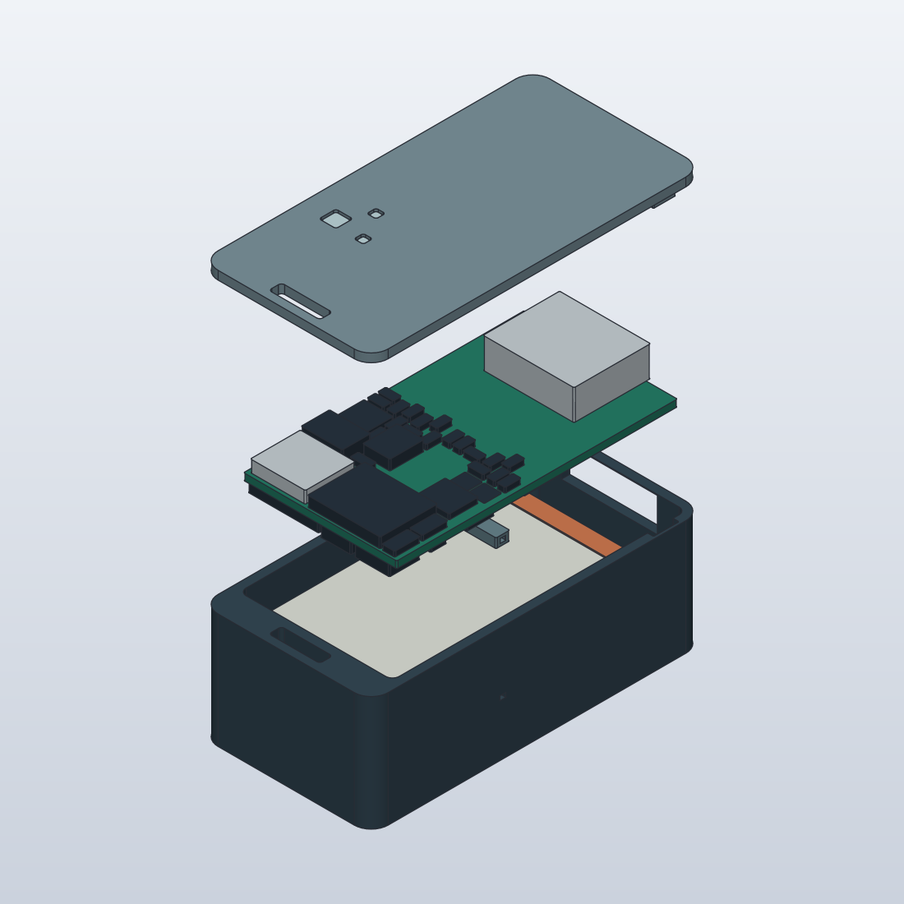
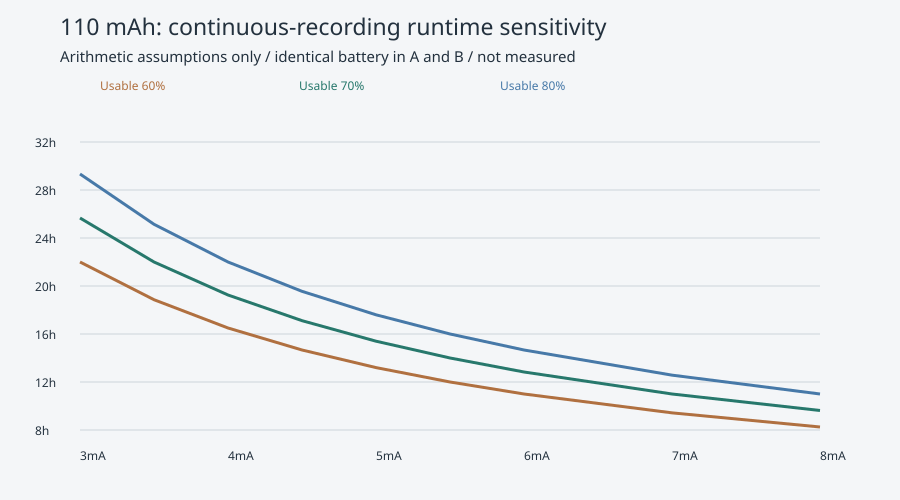

# A/B二案の配置・配線・構造比較

追記: 印刷用STLと充電回路の新しい制約は[発注準備記録](compact-order-refinement.md)を参照。下記の基板数値は元のA/B配置の記録。

2026-10-25。発注不可。これは実部品フットプリントを使った配置・部分配線と、全75部品の包絡を含むSolidCraft収納検討である。電気動作、量産寸法、16時間実動作の成立を保証しない。A/Bの2案のみ。旧Rev A/Bと混同しないよう `compact-a` / `compact-b` に保存した。

左からA、B、Omi寸法近似。共通CAD座標系を同じカメラでレンダリングしている。Omi公式販売ページの「2.5cm × 1.5cm」を直径25mm×厚さ15mmの円柱として解釈した。製品外形の複製ではなく、ケース・チェーン・紐結び目を含まない。A/Bの紐穴と固定部は外形内。外に出る紐と結び目は含まない。[公式掲載](https://get.omi.me/omi-quantity)（2026-10-25閲覧）。旧25.5mm近似は使わない。

|項目|A 薄型優先|B 小ささ優先|Omi比較用近似|
|---|---:|---:|---:|
|外形検討値 mm|38×39×8.9|20×39×14.5|直径25×15|
|正面包絡面積 mm²|1,482|780|490.9（円）|
|厚さ mm|8.9|14.5|15|
|直方体包絡 cm³|13.190|11.310|9.375|
|円柱体積 cm³|—|—|7.363|
|基板 mm|18×33×0.8|18×33×0.8|比較対象外|
|銅層 / 部品数|6層 / 75|6層 / 75|比較対象外|
|電池配置|基板の横|基板の下|比較対象外|
|配線・ビアオブジェクト数|1,264|1,264|—|
|ERC / 回路図等価性違反|0 / 0|0 / 0|—|
|配線後DRC / 未接続|9 / 10|9 / 10|—|

A/Bの基板は同じ部品と18×33mm共通配置を採用し、それぞれ独立して自動配線した結果も同一になった。筐体の積み方が2案の違いであり、電気回路を不必要に別設計にしていない。両側ともKiCad回路図、PCB、PDF、BOM、接続表、配置JSON、検査JSON、DSN/SESを保存した。配線数は完成率を表さない。

BはA比で正面面積47.4%減、包絡体積14.3%減。Omi比ではBも正面面積58.9%増、直方体包絡20.6%増となり、Omiより小さいとはいえない。A/Bの面積は角丸を差し引かない。異なる体積定義を混同しないようOmiの直方体と円柱を両方示した。

## 当初目標との差

当初のA 28×36×8.5mm、B 20×33×12mmは未検証目標だった。今回の配置で成立した寸法と呼べる段階でもないが、検討枠を上表へ改めた。

A: 電池15.5mm幅と18mm基板を横に並べ、絶縁/線の通路、壁を加えて38mm幅。8.5mmではUSB上に名目0.24mmしか残らず、部品高さ+0.2mm・ケース内寸−0.2mmの仮公差で0.16mm干渉した。8.9mmに増やすと仮公差適用後0.24mm残る。これはこの配置の結果であり、別の電池・端子・基板形状でも28mm幅が不可能という証明ではない。

B: 33mm基板に上下の壁、内蔵紐穴領域を加えて39mm長。電池上に音道を通す空間と裏面部品1.5mm、基板0.8mm、USB高さ3.56mmを積み、14.5mmを検討値とした。名目USB上0.54mm、同じ仮公差後0.14mm。12mmへ押し込んで合格扱いにはしない。今後の電気的再配置とメーカー最大寸法によって再拡大の可能性がある。

## 内部構造

灰青がケース/蓋、緑が基板、金色が電池、淡色が絶縁、橙が完成ハーネス用の予約空間。黒/銀の75個はKiCadから取得した実フットプリントの包絡。抵抗等を省略していないが、各部品メーカーSTEPの形状ではない。高さは部品種別の仮定で、コネクタ嵌合後高さ、はんだ、最大公差は未資格化。フットプリントのランド/コートヤード込み包絡を部品外形と混同しない。

- 壁/蓋1mm。紐スロット6×1.5mm、外形内。紐引張・皮膚接触・衣擦れは未試験。
- 2点の蓋爪と受け、PCB支持座、USB開口、ボタンプランジャ、2点LED導光部を作成。爪の0.2mm逃げは印刷仮定。保持力・組立経路・部品との精密干渉、USBプラグ樹脂形状は未検証。
- Aは電池と基板を横並びにして背面へ直通音道。衣擦れ/装着時の遮蔽評価が必要。
- Bは電池上面5.5mmと裏面部品下面7.1mmの間に、z=5.8〜6.9mmの横音道を置く。KiCadのU8音孔0.6mmの実座標に合わせて立上りを設けた。選定した包絡条件の横音道/部品交差は0件。ただし音道部材同士の結合、密閉ガスケット、音響特性、膨張を含む公差は未検証。
- 電池は15.5×27×4.2mm掲載値。完成線長/曲げ半径/膨張/NTC定数が不明のため、橙色の予約空間が実ハーネスを収納する保証はない。線の切断・圧着は前提にしない。

## 持続時間と保存容量の計算

`mechanical/compact-ab/runtime.csv` は32条件、`analysis.json` は27条件の負荷感度分析。`runtime.svg` はそのグラフ。算術モデルでありSPICE、電池の電圧曲線、電気/熱シミュレーション、実測ではない。

両案はDTP401525-XE 110mAh。同じ回路なので持続時間を別々の予測値にしていない。容量70%使用可能を仮定すると、平均4mAで19.25h、4.5mAで17.11h、5mAで15.4h。16hの電流上限は4.8125mA。容量60%なら4mAで16.5h。4mAは開発目標であり達成予測ではない。

負荷モデルは `I = 常時電流 + CPU増分8mA×稼働率 + SD増分30mA×稼働率`。電流と稼働率はいずれも感度入力で、データシート保証値ではない。3.3V LDOのドロップアウト、SD busy/ピーク、音声処理、age暗号化、寿命/温度の影響は実機で測る。連続録音の無音は捨てない。

16kHzモノラル、標準IMA-WAV（1024byte/2041samples）を10秒単位で標準age v1へ暗号化する予算では、36hで約1.062GB（4KiB割当と仮ヘッダ予算込み）。4GBに収まる算術結果であり、STM32への実装/性能検証は未完。独自保存コンテナ、本体平文一時ファイルは導入しない。確定ファイルの電源断回収、途中ファイルの認証失敗検出、PC側復号/完全性/永続化後に一致録音だけ削除する契約は維持。未同期上書き禁止。

## 調達と費用

[マルツEZ3セット](https://www.marutsu.co.jp/pc/i/2228265/)は閲覧時税込1,252円、5個6,260円＋送料。表示在庫192個の日時が2026-09-09で、10月25日時点の在庫保証には使えない。前回32個という記録も現在庫として扱わない。[千石XE掲載](https://www.sengoku.co.jp/mod/sgk_cart/detail.php?code=EEHD-5VAC)の最大包絡を採用し、PH版の仕様を流用しない。

電池の国内調達性を優先しているため、Aでは面積、Bでは厚さを負担する。6層/両面実装と同一BOMなので、A/B間でPCB原価が大幅に違う根拠はない。Aは大きいケース、Bは音道と積層の組立難度が費用要因。MCU/SD等のJLC受理、部品代、実装初期費、送料、税は正式見積り未取得。本体原価/5台費用を前の6〜13万円仮予算で確定しない。工具費は本体に混ぜない。注文・照会送信なし。

## 残件と次の判定

両PCBとも部分配線。9件はクリアランス4件と孤立/片層ビア5件、未接続10件。0.1mm線幅への正規化後に最小間隔0.0905mmが残った。DRC規則を緩めて消していない。配置段階のDRC0と配線後DRC9を取り違えない。回路図との等価性は0件。

USB差動配線、GND帰路、デカップリングと水晶、電源ピーク、T5838レベル変換、BQ25101と電池の温度適合を未検証。自動配置は収納検討であり電気的最適配置ではない。BQ25101を最終採用としない。Bluetooth/画面/クラウド/サブスクは追加していない。USB接続直後は充電のみで録音継続、同期は明示操作という仕様を維持する。

ファームは依然ESP32スタブでSTM32録音実装なし。macOS/Windows/Linuxの同期・age復号・WAV出力、ランダム電源断回復、16h連続録音は未達。今回の成果物を製造可能/実機動作済みとは呼ばない。Bを本命の収納方向として残すが、20×39×14.5mmも確定製品寸法ではない。
