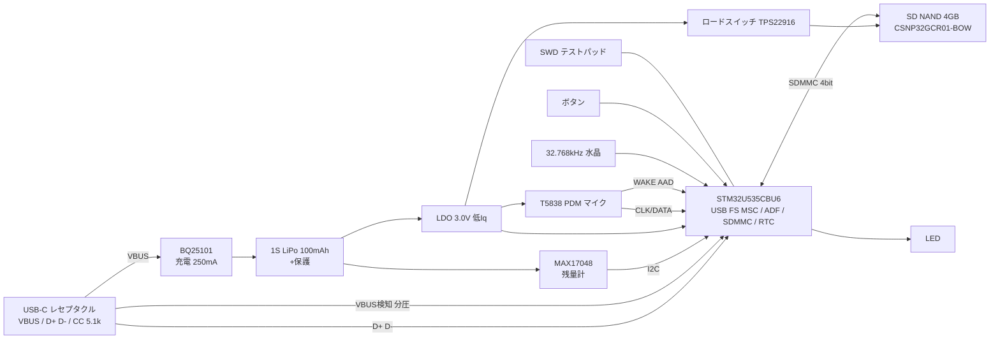

# カスタム基板設計（無線なし・USB-C 1本・16時間・ペンダント）

調査日: 2026-10-24。**[推定]** はデータシートの数字を組み合わせた見積りで、実測していない。出典は末尾。

## 0. 結論（推奨構成）
- **MCU: STM32U535CBU6**（Cortex-M33、UFQFPN-48 7×7mm、無線なし、USB FS device・SDMMC・MDF/ADF内蔵）
- **マイク: TDK T5838** ×1（PDM、Low-Power Mode 120µA、AADで無音時は20µA待機）
- **ストレージ: SD NAND CSNP32GCR01-BOW 4GB**（LGA-8 6.2×8mm、はんだ付けできるmicroSD相当、**SDMMC 4bit**接続）
- **保存: IMA-ADPCM WAV**（1日≒0.46GB）。PCM WAVは設定で切替
- **電源: BQ25101（充電）＋MAX17048（残量計）＋低Iq LDO 3.0V**
- **電池: 1S LiPo 100mAh級**（Omiの150mAhより小さくて済む見込み）
- 試作は **NUCLEO-U545RE-Q 等のST評価ボード**＋T5838ブレイクアウト＋SD NANDアダプタで、ファームと電流を先に確かめる

理由（要約）: 無線を捨てた以上、nRF系の強み（BLE）は使わない。一方で STM32U5 は **SDMMC 4bit**（SPIより速く、書き込みの「起きている時間」が短い）、**ADF/MDF**（PDMをハードで間引き、音声検知も内蔵）、**Stop 2 3.0µA・Run 16.3µA/MHz** と、この用途に必要なものが一通り載っている。nRF52840 は Omi のコードを流用できるのが最大の利点で、電力差は電池容量に効くほど大きくない[推定]。そのため「確実に作れる」側として nRF52840 を**第2候補**に残す。

## 1. 候補比較

| 項目 | **STM32U535（推奨）** | nRF52840（Omi DK系） | nRF5340（Omi Consumer） | RP2350 | STM32L4+（L4R5等） |
|---|---|---|---|---|---|
| 無線 | なし | BLE（使わない） | BLE（使わない） | なし | なし |
| CPU実行電流 | 16.3µA/MHz @3.3V [ST-U535] → 16MHzで約0.26mA | 64MHz CoreMark 3.3mA（DC/DC）[N52-CPU] | 未調査（nRF52840と同程度と推定） | SLEEPでも5.9mA [RP-SDK表, IMPL] → 録音中は数mA〜十数mA[推定] | 未確認（U5より大きい[推定]） |
| 待機 | Stop2 3.0〜4.6µA、Standby+RTC 370nA [ST-U535] | System ON 1.5µA, OFF 0.4µA [N52-PS] | 低い（未調査） | DORMANT 3.3mA、P-state 0.18〜0.25mA [IMPL] | 低い（未確認） |
| USB | FS device [ST-U535] | FS device [N52-PS] | FS device | FS device | FS OTG |
| PDM | MDF＋**ADF（音声検知付き）** [ST-U535] | PDM＋EasyDMA [N52-PS] | PDM | PIOで実装（ハードなし） | DFSDM（未確認） |
| SD接続 | **SDMMC 4bit** | SPI（Omi DK2: 24MHz）[omi-ref F2] | SPI（Omi: 24MHz）| PIO SDIO（ライブラリ依存） | SDMMC |
| パッケージ | UFQFPN-48 7×7（手はんだ可能だが要リフロー推奨） | aQFN73 7×7 / QFN48 6×6 / WLCSP | WLCSP-95（手はんだ不可）[omi-ref D3] | QFN-60 7×7 | LQFP/UFBGA |
| JLCPCB部品 | LCSC C26442222 [LCSC-U535] | あり（型番は未確認） | 不明 | あり（未確認） | 未確認 |
| 外付け必須 | 32.768kHz水晶（RTC精度用）、デカップリング | **32MHz水晶必須**＋32k水晶、DC/DC用L | 同左＋α | 外付けQSPIフラッシュ必須、12MHz水晶 | 水晶 |
| ツール | STM32CubeU5（USBX MSC, MDF/ADF HAL）または Zephyr | **Zephyr/NCS＋Omiコード流用** | Zephyr/NCS（Omi Consumer） | Pico SDK / TinyUSB | Cube / Zephyr |
| 評価 | ◎ 電力・SD速度・部品点数 | ○ コード流用、実績 | △ WLCSP・過剰 | ✕ 平均電流が大きすぎる | ○ ただしU5の下位互換 |

補足:
- RP2350 は動作中の低電力モードが弱く、SLEEPでも数mA（[RP-SDK表]）。16時間で数十〜100mAh以上を CPU だけで使う見込み[推定]で除外。
- nRF5340 は WLCSP で手はんだ不可、無線不要なら選ぶ理由がない。
- STM32U5 の LPBAM（Stop2で自律動作）は ADF と LPDMA が対象で、**USB と SDMMC は対象外** [ST-AN5652]。よって「ADFでSRAMにためる（Stop2）→ 数秒ごとに起きてSDMMCへ一括書き込み」という間欠動作になる。

## 2. 部品ごとの判断

### マイク: T5838（Omi Consumerと同じ）
- Low-Power Mode: 120µA typ（SCK 768kHz, 1.8V）、SNR 65dBA。High Quality Mode: 310µA、SNR 68dBA [T5838-DS]
- AAD Analog: 20µA（クロック停止）で音が来たらWAKEピン割り込み [T5838-DS]
- 方針: 通常は Low-Power Mode で常時録音。AADは「静かな時間は録らない」オプション（頭切れ対策に ADF のバッファ＋前後1〜2秒）
- 1個で開始。2個（ビームフォーミング・こすれ音除去）は試作で音質を見て判断

### ストレージ: SD NAND（推奨） vs microSD vs eMMC vs 生NAND
| 方式 | 長所 | 短所 | 判定 |
|---|---|---|---|
| **SD NAND 4GB CSNP32GCR01-BOW** | はんだ付け、6.2×8×0.75mm、SDプロトコルなので普通のFATがそのまま、ECC・不良ブロック管理内蔵 [CS-DS] | 4GBまで（このシリーズ）、0〜70℃、待機150µA typ [CS-DS] | ◎ |
| microSDスロット | 大容量・交換可 | スロットが厚く大きい、接触不良、紛失 | 試作のみ |
| eMMC | 大容量 | BGA-153、1.8V I/O、電流大、MCU側ドライバ重い | ✕ |
| 生NAND | 安い | ECC・ウェアレベリング・FTLを自作、MSCで見せるのが大変 | ✕ |

- 書き込み電流 15mA typ / 25mA max（3.3V, 50MHz）、待機 150µA typ [CS-DS]
- 4GB = PCMなら約2日、ADPCMなら約8日分

### 保存形式
| 形式 | ビットレート | 16h容量 | CPU負荷 | 判定 |
|---|---|---|---|---|
| PCM WAV | 256kbps | 1.84GB | ほぼゼロ | 試作・音質基準 |
| **IMA-ADPCM WAV** | 64kbps | 0.46GB | 軽い（数MHz相当[推定]） | **本命** |
| Opus（Omiと同じ32kbps CELT） | 32kbps | 0.23GB | 重い（Omiはcomplexity 3）。MCUが長く起きる | 後で検討 |
- ADPCM は SD書き込み時間と USB 吸い出し時間を1/4にする。文字起こし精度への影響は未確認（open-questions）

### 電源
- 充電: **TI BQ25101YFPR**（DSBGA-6、最大250mA、Omiと同じ）LCSC C478468 [LCSC-BQ]
- 残量計: **MAX17048G+T10**（DFN-8）LCSC C2682616 [LCSC-MAX]。ADC＋分圧（常時電流が流れる）より正確。Omiは別方式（battery.cの放電カーブ）
- 電池保護: Omi BOMの GLF73910 相当、または保護回路付きセルを使う
- 3.0V LDO（低Iq品、例: TI TPS7A02 系。LCSC番号は未確認）: SD NANDの下限2.7V [CS-DS] を満たし、MCU（1.71V〜）、T5838も同じ電源で動かす（T5838の電源範囲はデータシートで要確認）。電流が数mAなので降圧DC/DCより部品が少なくて済む
- ロードスイッチ（Omiと同じ TPS22916）でSD NANDの電源を切れるようにしておく（待機150µAを0にする実験用）

### RTC・時刻
- STM32U5内蔵RTC＋32.768kHz水晶。USB接続時に Mac が `TIME.TXT` を書く→取り外し時にファームが読んでRTCを合わせる
- 電池が切れたらRTCも止まる。その場合はファイル名に「未設定」フラグを付け、Mac側でコピー時刻から逆算

### UI
- タクトスイッチ1個（Omi DK2と同じ4×4mm）、LED 1個（0402、1mA以下で短く点滅）
- デバッグ: SWD用のテストパッド（Tag-Connect TC2030 か ポゴピン5点）

## 3. 電力見積り（録音中・すべて [推定]）

前提: 電池3.7V、LDO 3.0V（LDOの電流はそのまま電池から）。データシートの typ 値を組み合わせたもの。

| 項目 | STM32U535 案 | nRF52840 案 | 根拠 |
|---|---|---|---|
| CPU（間欠、平均） | 0.3mA（16MHz相当で常時動作と仮定） | 0.5〜1.0mA（PDM用HFXO＋割り込み、64MHz） | [ST-U535] 16.3µA/MHz, [N52-CPU] |
| PDM/ADF周辺 | 0.1〜0.3mA | 0.2〜0.5mA | 未確認、要実測 |
| マイク T5838 LPM | 0.12mA | 0.12mA | [T5838-DS] |
| ストレージ書き込み | ADPCM: 15mA×(8KB/s÷約5MB/s)≈0.03mA ＋待機0.15mA | SPI 24MHzで書き込み時間が長く 0.1mA＋待機0.15mA | [CS-DS]、転送速度は推定 |
| 残量計・LDO・LED | 0.05mA | 0.05mA | MAX17048 データシートで要確認 |
| **合計** | **約0.8〜1.0mA** | **約1.1〜2.0mA** | |
| 余裕×2で設計 | 2mA | 4mA | |
| 16時間に必要 | 32mAh | 64mAh | |
| 推奨電池 | **80〜100mAh** | **100〜150mAh** | 劣化・低温で7割と想定 |

- XIAO等の市販ボードは USB-シリアル・LED・レギュレータで数mA上乗せされるので、この表は**自作基板**の値
- 最大の不確実性は「周辺（PDM/ADF・DMA・クロック）」の電流と、SD NANDの実際の書き込み時間。最初の実測で確かめる

### 電池の大きさ・重さ（目安）
| 容量 | 例 | サイズ | 重さ |
|---|---|---|---|
| 80〜100mAh | 401230 / 401525 クラス | 約4×12×30mm 前後 | 約2〜3g（一般的な値、未確認） |
| 150mAh | Omi GRP1654M1（円筒 D16×H6.1）| [omi-ref BOM] | 未確認 |
- 丸いペンダントに収めるなら、Omiと同じ**ボタン型（円筒）セル**の小さい版（例 D16×H4程度、70〜100mAh）を探すのが最良。入手性は未確認

## 4. ブロック図

## 5. 回路ブロックごとの注意
- **USB-C**: 16ピンの USB2.0 専用レセプタクル（ミッドマウント型で薄く）。CC1/CC2 に各5.1kΩプルダウン（Sink）。ESD保護（USBLC6-2 等、LCSC番号未確認）。D+/D-は90Ω差動、短く
- **VBUS検知**: VBUS→分圧→MCUのGPIO（STM32U5のUSBにVBUS sense機能があるかは要確認）。VBUSで「録音停止→ファイルを閉じる→MSC開始」
- **充電**: BQ25101のISET抵抗で充電電流を電池容量の1C以下（100mAhなら100mA）に。TS端子は電池サーミスタが無ければデータシート通りに処理
- **電源**: 電池→LDO 3.0V→全体。充電しながら動かすのでパワーパス（BQ25101は持たない）の扱いに注意：USB接続中は「充電電流−システム電流」になる。MSC中の数十mAを考えて充電電流設定（open-questions）
- **マイク**: T5838はOmi Consumerと同じトップポート。筐体の穴と音響シール（Omi BOMのメッシュ）を真似る。PDM CLK配線は短く、GNDで囲む
- **SD NAND**: CMD/DAT0-3に10〜50kΩプルアップ（SD仕様）。電源は47µF程度のバルク（書き込みピーク25mA）
- **MCU**: VDD毎に100nF、SMPS/LDOどちらで内部電源を作るか（U5はSMPS内蔵。SMPSならLが要る）。BOOT0、NRSTをテストパッドへ
- **残量計**: MAX17048は電池直結。ALRTを低電圧割り込みに

## 6. 基板・筐体
- 基板: **直径22mm円形、4層、0.8mm**（Omi Consumerは4層0.6mm 21×21mm＋ブラインドビア [omi-ref D3]。こちらは費用を抑えるため貫通ビアのみで始める）
- 片面実装（部品面）＋裏面に電池。部品面の高さはUSB-Cレセプタクルが最大（約3mm）
- 厚さの見積り[推定]: 基板0.8＋部品3.2＋電池4〜5＋ケース肉厚2×1.2 = **約11mm**（Omi約15mm）
- 外形: 直径25〜26mm（Omiと同等）、重さ 10g前後目標[推定]
- 筐体: 試作は3Dプリント（SLA）。USB-Cの口、マイク穴＋メッシュ、LED導光、ボタン。Omi Consumer の STEP（`mechanical/`）を寸法の基準にする
- JLCPCB PCBA: 4層小型基板＋SMT。UFQFPN/DSBGA/LGA-8はリフロー前提（DSBGA-6のBQ25101は手はんだ不可）

## 7. 段階計画
1. **フェーズ0（今の机上）**: この文書・要件・BOMを確定
2. **フェーズ1 評価ボード試作（2〜3週）**: ST NUCLEO（U545等、型番は要確認）＋T5838ブレイクアウト＋SD NAND変換基板（またはmicroSD）。ADF→ADPCM→SDMMC→FAT、VBUSでUSB MSC切替、`TIME.TXT`。**PPK2で平均電流を実測**
   - 並行して、既存の XIAO nRF52840 Sense 試作（Omi流用）でも同じ測定をして比較。差が小さければ nRF52840 カスタム基板に切替もあり
3. **フェーズ2 1次カスタム基板（30×30mm角、2〜4層、テストパッド多め）**: 回路の正しさと電流の確認。JLCPCB PCBA 5枚
4. **フェーズ3 円形22mm基板＋筐体**: 実装サイズを詰めて、装着テスト（こすれ音・重さ・1日持つか）
5. **フェーズ4 Mac側**: マウント検知→コピー→検証→文字起こし→Notion（host/）

## 出典
- [ST-U535] STM32U535xx Datasheet DS14217 Rev5: https://www.st.com/resource/en/datasheet/stm32u535cb.pdf
- [ST-AN5652] AN5652 How to optimize power consumption on STM32U5: https://www.st.com/resource/en/application_note/an5652-how-to-optimize-power-consumption-on-stm32u5-mcus-stmicroelectronics.pdf
- [LCSC-U535] https://www.lcsc.com/product-detail/C26442222.html
- [N52-CPU] https://docs.nordicsemi.com/r/bundle/ps_nrf52840/page/_tmp/nrf52840/autodita/current/parameters.i_cpu.html
- [N52-PS] https://docs.nordicsemi.com/r/bundle/ps_nrf52840/page/keyfeatures_html5.html
- [RP-SDK表, IMPL] RP2350の SLEEP/DORMANT/P-state 電流（Pico SDKの表を引用したブログ）: https://blog.implrust.com/posts/2026/08/deep-sleep-powman-rp2350-raspberry-pio-pico/ ／ データシート: https://pip-assets.raspberrypi.com/categories/1214-rp2350/documents/RP-008373-DS-2-rp2350-datasheet.pdf
- [T5838-DS] https://www.farnell.com/datasheets/4761948.pdf ／ https://invensense.tdk.com/news-media/tdk-introduces-worlds-lowest-power-PDM-microphone-with-acoustic-activity-detect/
- [CS-DS] CSNP32GCR01-BOW: https://datasheet.lcsc.com/datasheet/pdf/bfa5f23b6901abecebf24c347afa6e3d.pdf?productCode=C5440134 ／ LCSC C5440134: https://www.lcsc.com/product-detail/C5440134.html
- [LCSC-BQ] https://www.lcsc.com/product-detail/C478468.html
- [LCSC-MAX] https://www.lcsc.com/product-detail/C2682616.html
- [omi-ref] docs/omi-reference.md
