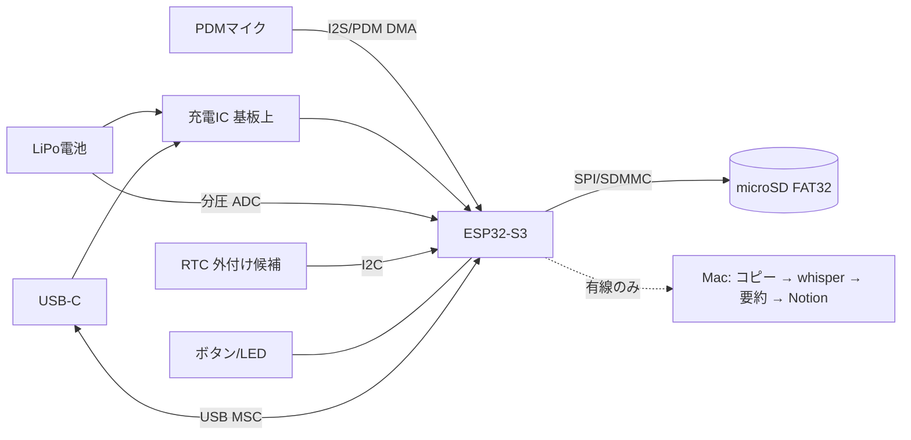

# 設計書（たたき台）

> **履歴資料・現行設計ではない。** 以下はXIAO/ESP32/microSDを比較した初期案。現行XE量産候補は `hardware/xe-minimal/active-design.json`、要件は `docs/requirements.md`、電流・保存容量は `docs/sourcing/xe-integrated-16h-budget.md` を正とする。現行は32Gbit（4GB公称）の基板実装SD NANDで、購入者がmicroSDを用意しない。

## 1. 要件
| # | 要件 |
|---|---|
| R1 | ペンダント型で、1日中つけていても目立たない（目標: 本体30g以下、厚さ15mm前後。いずれも目標値） |
| R2 | 常時録音、または声を検知したときだけ録音し、16時間以上もつ |
| R3 | Bluetooth・アプリ・クラウド・サブスクなし |
| R4 | USB-CでMacにつなぐと、充電しながらUSBドライブ（MSC）として見える |
| R5 | Macで日本語を文字起こしできる程度の音質（16kHz・モノラルを想定） |
| R6 | 要約してNotionへ保存（Mac側。今回はスケッチのみ） |

## 2. 全体構成

- 録音モード: マイク → DMAバッファ →（声の検知）→ WAVを分割してSDへ書き込み
- USBモード: USBの電源を検知したら録音を止め、ファイルを閉じてから、SDをMSCとしてMacに見せる。充電はこの間も基板上の回路で行われる

## 3. ボード比較
| 項目 | XIAO ESP32S3 Sense | XIAO nRF52840 Sense | RP2040 / RP2350 + PDMマイク |
|---|---|---|---|
| マイク | 基板にPDMマイクあり | 基板にPDMマイクあり | 外付け（例: SPH0641などのPDMマイク） |
| microSD | 拡張ボードにスロットあり | なし（外付けが必要） | なし（外付けが必要） |
| USB MSC | TinyUSBのMSCが使える（ネイティブUSB） | TinyUSBのMSCが使える | TinyUSBのMSCが使える |
| LiPo充電 | 基板上にあり | 基板上にあり | XIAO RP2040は充電ICなし（要確認）。Pico系も外付け |
| 録音中の消費電流 | **約64.5mA @3.8V（マイク録音＋SD書き込み、Seeed公式Wikiの値）** [1] | 推定で数mA〜10mA台（要実測。SDの書き込み電流が別にかかる） | 推定で20〜30mA台（要実測） |
| 無線（不要） | Wi-Fi/BLEあり。オフにすれば使わない | BLEあり。オフにすれば使わない | RP2040は無線なし |
| 総評 | すぐ作れるが電力が最大の弱点 | 省電力では有力。SDを足すので配線とケースが増える | 中間。部品は増える |

[1] Seeed Studio Wiki「Getting Started with XIAO ESP32-S3 Series」仕様表: Sense の「Microphone recording & SD card writing」は電池3.8V時に平均64.5mA、ピーク109.3mA。Light-sleepは約5mA（カメラ込みの値）。https://wiki.seeedstudio.com/xiao_esp32s3_getting_started/
- 同じWikiに、カメラとSDを初期化したまま寝かせると電流が下がらない、という報告がフォーラムにあります。**カメラは物理的に外す前提**にします。https://forum.seeedstudio.com/t/esp32s3-sense-camera-very-high-deep-sleep-current-any-solution/274705
- nRF52840 / RP2040 の値はデータシートで確認していない推定です。試作して実測するまで、比較のための目安と考えてください。

**判断**: 1台目は XIAO ESP32S3 Sense で作り、録音・保存・USB・時刻の流れを確かめます（最短で動くため）。電力が足りなければ、2台目で nRF52840 + 外付けSD に移ります。

## 4. 電力の見積もり（16時間）
前提（すべて推定・要実測）:
- 電池の公称3.7V。安全マージン（電池の劣化、低温、使い切らない分）として×1.25
- 常時録音のときの平均は、公式値の64.5mA [1]
- 声の検知で録音する場合: 声がある時間を30%とし、録音中は64.5mA、待機中（マイクは動かしたまま、CPUは低いクロック、SDは書かない）は25mAと仮定（**25mAは根拠のない仮置き**）

| ケース | 平均電流 | 16時間で必要な量 | マージン込み |
|---|---|---|---|
| ESP32S3 常時録音 | 64.5mA | 1,032mAh | **約1,300mAh** |
| ESP32S3 声の検知（30%） | 約37mA（推定） | 約590mAh | **約740mAh** |
| nRF52840 常時録音（仮に10mA） | 10mA（推定） | 160mAh | **約200mAh** |

重さの目安: LiPoは一般に1,000mAhで20g前後、500mAhで10g前後が多い（製品によって違うので要確認）。
→ **ESP32S3で常時録音すると電池だけで25g前後になり、ペンダントとしては重い**。声の検知と低いクロックで平均を30mA以下に下げられるかが最大の検証項目です。

ESP32S3で電力を下げる案:
- CPUを80MHz程度に下げ、Wi-Fi/BLEは起動しない
- 書き込みはPSRAMにためて、数十秒ごとにまとめてSDへ（SDの待機時間を長くする）
- 声の検知は軽い方式（音の大きさ＋ゼロ交差の回数）から始める
- 声がない間は、DMAでマイクを読みつつlight sleepに入れるかを検証（できるかは未確認）

## 5. 音声フォーマットと1日の容量
- 16kHz / 16bit / モノラルのWAV（PCM）= 32KB/秒 ≒ **1時間で約115MB、16時間で約1.8GB**
- 32GBのmicroSDなら2週間以上ためられる計算です
- 圧縮（ADPCMやOpus）は電力と実装の手間がかかるので、最初はWAVにします
- ファイルは5分ごとに分割します（電池切れで壊れても失うのは最後の5分だけ）。ファイル名は `YYYYMMDD_HHMMSS.wav`
- whisper系は16kHzモノラルで動くので、Mac側で変換しなくて済みます

## 6. 時刻（ネットワークなし）
- ESP32の内蔵RTCは、電源が切れると時刻が消え、精度もよくありません
- 案A（推奨）: USBでMacにつないだときに、Mac側スクリプトがSDの `TIME.TXT` に今の時刻を書き、次に起動したときにファームがそれを読む。各WAVの先頭に起動からの経過時間も残す
- 案B: 小さな外付けRTC（例: RV-3028系。超低消費・バックアップ可）をI2Cでつなぐ。部品と重さが増える
- Mac側では、ファイル名の時刻とファイル内の経過時間から実際の時刻を出します

## 7. USB MSCと充電
- USB-Cをつなぐと、基板上の充電回路が電池を充電します（公式Wikiでの充電電流はSenseの欄に未記載、無印は50mA(Fast)、Plusは100mA。要確認）
- ファームはUSBの接続（VBUS）を検知したら、録音を止め、開いているファイルを閉じ、SDの使用をやめてから、TinyUSBのMSCでSDを見せる
- **SDをファームとMacが同時に触るとファイルシステムが壊れる**ので、MSCの間はファームから書き込まない
- 取り外されたら（VBUSが落ちたら）録音に戻る
- 書き込みがSPI経由なので、MSCでのコピー速度は遅いはず（1日分1.8GBでどれだけかかるか要実測）。遅すぎる場合はSDカードを抜いてカードリーダーで読む、を予備策にします
- XIAO ESP32S3のVBUSを検知するピンがあるかは要確認（なければ分圧してGPIOで読む）

## 8. ケース
- 3Dプリント（PETGかレジン）で、ペンダント型（例: 直径40mm前後の円形、または35×25mmの角丸）
- マイク穴は外側に向け、布でこすれる音を減らすためにメッシュかフェルトを貼る
- USB-Cの口とmicroSDを抜く口を用意する
- ボタン1つ（録音の一時停止）とLED1つ（録音中を示す。目立たないように暗くする）
- 首ひもはブレイクアウェイ式（引っ張ると外れる）にする
- 周りの人の同意の扱いは運用で決める（open-questions参照）

## 9. Mac側（スケッチ）
1. ボリューム `PENDANT` のマウントを検知
2. `~/Lifelog/raw/日付/` にコピーし、ハッシュが一致したらSD側を消すかはユーザー設定（初期値は消さない）
3. mlx-whisper（kotoba-whisperのMLX版など）で文字起こし
4. ローカルのLLMで日ごとに要約し、Notion APIで保存（未実装）

## 10. Omi-cloneパス（2026-10-24追加）と推奨
詳細と出典は `docs/omi-reference.md`。Omiは「XIAO nRF52840 Sense＋Zephyr」（DevKit）→「nRF5340＋T5838×2＋150mAh＋BQ25101」（Consumer）と進化している。

| 項目 | A: ESP32S3パス（従来） | B: Omi-clone 試作（DevKit2を真似る） | C: Omi-clone 本番（Consumerを真似る） |
|---|---|---|---|
| MCU | XIAO ESP32S3 Sense | XIAO nRF52840 Sense | nRF52840モジュール or nRF5340（自作基板） |
| マイク | 基板上PDM | 基板上PDM | TDK T5838（AADで無音時スリープ） |
| 保存 | microSD（拡張ボード） | microSD SPI（DK2と同じ `sdhc-spi-slot`）＋FAT/exFAT | microSD or SD NAND（CSNP系）＋FAT |
| USB | TinyUSB MSC | Zephyr USB MSC | Zephyr USB MSC、USB-C直結（Omiの磁気ポゴはやめる） |
| 充電 | 基板上 | 基板上 | BQ25101（Omiと同じ）＋保護IC |
| 電池 | 740〜1,300mAh（試算） | 250mAh（DK2と同じ502030）から実測で調整 | 150〜300mAh |
| ファーム | Arduino/PlatformIO（`firmware/` の骨組み） | Zephyr/NCS。Omi `firmware/devkit` のoverlay・SD・PDMを流用 | Omi `firmware/omi` の mic/AAD/電源制御を流用 |
| 難易度 | 低 | 中（NCSの環境構築） | 高（WLCSPはリフロー必須） |

**推奨**: 本命をB（Omi DevKit2クローン）に切り替える。
- 理由1: ESP32S3は公式値で録音時64.5mA。電池が重くなりペンダントにならない
- 理由2: Omiが同じボードでSD保存（実験的）まで実装済み。差分は「BLE送信を消す」「USB MSCを足す」「保存をFATの普通のファイルにする」の3点
- 理由3: 将来Cへ進むとき、同じZephyrのコードがそのまま使える
- Aは捨てずに「1日で動く確認用」として残す（`firmware/` = PlatformIO）。B用は `firmware-zephyr/` を新設予定

B の保存形式の候補（未決）: (1) WAV 16kHz/16bit（115MB/h, 実装が簡単, 書き込み電力大）(2) Omiと同じOpus 32kbps（約14MB/h, nRF52840でエンコード可能な実績あり, Ogg/Opusコンテナにすればffmpeg/whisperで直接読める）。まずWAVで動かし、電力実測後にOpusへ。
