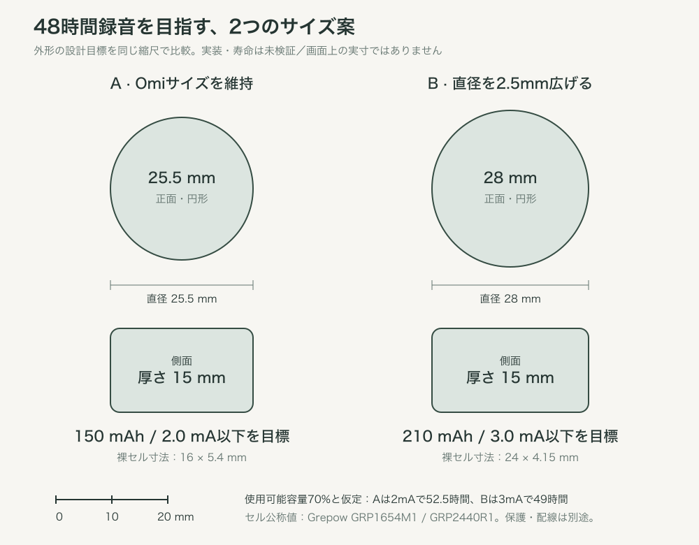

# 旧案: 2日無充電の録音とサイズ比較

> 現在の目標は[連続24時間](runtime-target.md)。以下の48時間・電池比較・図は旧案の履歴で、現行要件ではない。

> 最新追記: 円形制約を解除。Omi相当の小ささで密度を優先し、24×24×14mm角丸外形・21×21mm両面基板を第一の検討枠とする。未配置・未検証。以下の円形寸法は従来の比較案として保持。[最新方針](density-study.md)。

2026-10-24。ユーザー要望「2日充電なくていい」を、まず**連続48時間録音**の設計目標として扱う。従来の16時間から更新。日中だけ16時間×2日=32時間録音＋16時間待機は参考条件として分ける。無音区間を捨てて48時間とする方式は採用しない。

## 比較案（完成寸法・電池寿命の保証ではない）

| 案 | 外形の目標（直径×厚さ） | セル候補 | セルのみの公称寸法・重量 | 48時間用の電池端平均電流上限 |
|---|---|---|---|---|
| A: Omiサイズ優先、本命 | 25.5×15mm | GRP1654M1、150mAh、4.2V充電 | 16×5.4mm、2.95±0.2g | 2.19mA、設計目標は2.0mA以下 |
| B: 電池の余裕を優先、比較案 | 28×15mm | GRP2440R1、210mAh、4.2V充電 | 24×4.15mm、5.8±0.5g | 3.06mA、設計目標は3.0mA以下 |

Aの外形は既存の[Omi調査](omi-reference.md)を基準とする。Bは今回の設計提案で、実製品の寸法ではない。Bは直径+2.5mm（約10%）、正面積・同厚の円柱体積は約21%増える。セルだけでAより約2.85g増える。本体全体の重量は未算出で、旧12g目標を保証しない。

図は寸法を比例表示した概略図。画面上の実寸ではなく、ボタン・紐・USB開口の実配置を確定したCADではない。

## 計算の条件

電池の公称容量の70%を使用可能とする**仮の設計予算**を置く。劣化、温度、容量ばらつき、LDOのドロップアウトや停止電圧による取り出せない容量をまとめた仮定で、最悪条件の保証ではない。平均電流は電池端で測り、MCU・ADF・SDの内部busy・マイク・LDO・保護回路・全LEDを含める。

`録音時間[h] = 容量[mAh] × 0.70 / 電池端平均電流[mA]`

| 平均電流 | A: 150mAh | B: 210mAh |
|---|---:|---:|
| 2mA | 52.5時間 | 73.5時間 |
| 3mA | 35時間 | 49時間 |
| 4mA | 26.3時間 | 36.8時間 |

32時間録音＋16時間待機の場合は `32×I録音＋16×I待機 ≤ 容量×0.70`。待機電流をゼロ扱いしない。3mA録音ならAは待機平均0.56mA以下でこの条件に届く計算だが、連続48時間の達成とは区別する。

従来custom-pcb.mdの0.8〜1.0mA見積りは周辺電力・SD busy・LED追加を十分検証していないため、達成値として使わない。録音LEDを仮に0.3mAで48時間常時点灯すると14.4mAhを使う。残量3点は短時間表示にし、録音表示も低電流で必要な視認性を確保する。表示の必須要件は維持する。

## 収まりの検証条件

- Aは22mm円形基板を初期枠とする。150mAhの16mm径セルを基板裏へ重ね、USB-Cと干渉しない位置を検討する。
- Bは24mm径セルのため25.5mm外径には押し込まない。28mm外径・壁厚1.2mmなら内径25.6mmで、裸セルに対する径方向余白は片側0.8mm。タブ・絶縁・保護回路・公差まで含めた成立は未確認。
- 厚さ15mmの概算予算: 上下壁2.4mm、基板0.8mm、両面部品の高さ合計3.0mm（仮）、セルA 5.4mm / B 4.15mm、絶縁・組立余裕1.0mm。合計A 12.6mm / B 11.35mm。残り2.4mm / 3.65mmを固定・保護回路等に使えるか確認する。これは一次元の予算であり、USB・音響経路・ネジ・配線を含めた3D干渉確認ではない。
- メーカー掲載値は裸セル。保護基板、配線、端子、NTCを含むパック寸法・入手性・少量販売・送料は未確認。セルに直接はんだ付けせず、リードと保護回路を備えた組立品を調達する方針。
- Omi BOMのGRP1654M1パック厚約6.1mmと、今回のメーカー裸セル厚5.4mmは同一寸法として扱わない。実調達パック図面で上の厚さ予算を更新する。

## 回路・保存・検証への反映

- Aを本命とし、2.0mA以下を狙う。実測が2.19mAを超える場合は省電力化を検討し、Bのサイズ拡大案と比較する。Bへの変更はまだ確定しない。
- 4.2V充電セルを比較したためBQ25101の電圧設定と一致する。現回路の50mA充電は維持した見積り。容量/電流だけでもAは3時間、Bは4.2時間で、実際はCV区間等が加わる。充電電流を上げる場合はセル仕様、USB入力電流、発熱を再検証する。
- 48時間のADPCM音声本体は約1.38GB＋ブロック/ファイル/FSの付加分。4GBで収容する方針を維持。PCMは約5.53GBで4GBに入らないため、48時間の標準モードはADPCM。PCMは短時間の音質検証用とする。空き容量不足で自動削除しない。
- 日中/夜間の実音で48時間連続記録、ファイル継続性、低電圧時の安全な終了、表示・SD電流、USB-C充電のみ/同期を検証する。平均電流だけでなくSD書込み時の電圧降下を測る。
- 現状は仕様と寸法予算の更新。回路原本の電池候補はまだ100mAh級の旧注記があり、セル・保護回路確定後にBOMを更新する。基板配置・製造用ケース・48時間実測は未完了。

## 一次資料（2026-10-24確認）

- Grepow GRP1654M1: https://www.grepow.com/button-cell-battery/grp1654.html — 150mAh、3.7V/4.2V、16×5.4mm、2.95±0.2g。
- Grepow GRP2440R1: https://www.grepow.com/button-cell-battery/grp2440.html — 210mAh、3.7V/4.2V、24×4.15mm、5.8±0.5g。別モデルGNは4.4V用なので混同しない。

メーカー公称値と本設計の計算値・外形提案を区別する。48時間と外形は未達成の目標。
