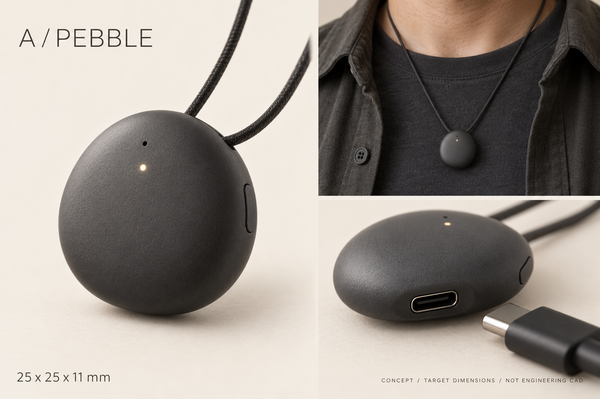
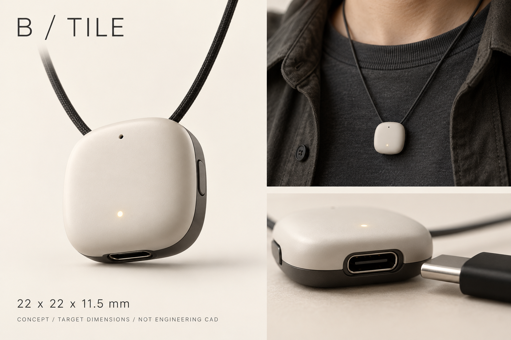
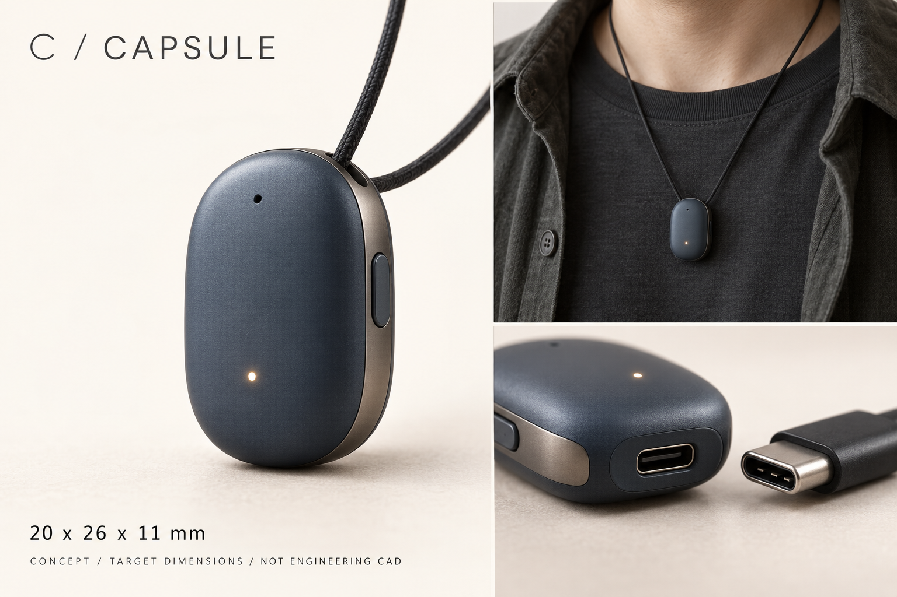
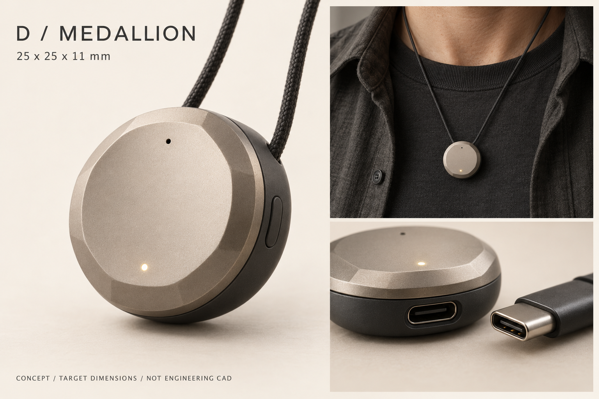

# 外観4案 — 2026-10-24

全案に**本体直挿しUSB-C（充電のみ／充電＋USB MSC同期）**を設ける。接続直後は充電のみで録音状態を維持し、同期操作をしたときだけUSBドライブを公開する。端子は下端、キャップ/専用充電台なし。画像は内蔵image_genによる外観コンセプトで、寸法・装着スケール・端子形状を保証するCADではない。生成プロンプト全文は [prompts.json](prompts.json)。既存SolidCraftモデルとは別の検討案で、形状選択後にCAD化する。

## 競合から参考にした点

- **Mori Journaling AI**: [公式製品ページ](https://mori.to/ja/product)の正面・側面・端子・装着写真を確認。丸みの強い角丸形、マットな外装、丸いボタン、小さな表示灯、短いグリル、上部の装着アダプターが特徴。公式寸法32.6×31.6×13.45mm、本体15g、USB-C充電。丸みと服へのなじみ方を参考に、今回は装着用の大きな張り出しを抑える。
- **Limitless Pendant**: [公式の正面画像](https://www.limitless.ai/media/pendant/black/pendant-front.webp)で円形の正面、円弧状グリル、上部クリップ形状を確認。[実機レビュー](https://tollbit.forbes.com/sites/forbes-personal-shopper/article/best-ai-wearables/)では磁気クリップ/紐での装着とUSB-C充電を確認。丸い形と装着部の一体感を参考にする。常設クリップは厚みと重さが増えるため、今回は紐が基本で、必要なら着脱式クリップを後で検討する。
- **Omi**: [公式製品ページ](https://www.omi.me/pages/pendant)と既存の回路/筐体調査を参照。円形の小型外形と内部積層は継承候補。充電台方式は採用せず、本体にUSB-Cを置く。

上記の外観評価は写真を見た設計上の判断。競合の実寸と下記の目標寸法を混同しない。競合写真そのものはこの公開リポジトリに転載していない。

## 比較

| 案 | 目標の幅×高さ×厚み | 目指す印象 | 機構上の課題 |
|---|---|---|---|
| A PEBBLE | 25×25×11mm | チャコールの小石。服に自然になじむ本命 | 丸みを強くすると内部容積が減る。USB付近だけ小さな平面を確保 |
| B TILE | 22×22×11.5mm | アイボリーの角丸タイル。小さく清潔感がある | 22mm円形基板は収まらない。角丸形に合わせた小型基板と電池選定が必要 |
| C CAPSULE | 20×26×11mm | 青灰色の細いチャーム。首元を縦にすっきり見せる | 内幅が厳しく、基板・電池を長手方向に再配置する必要がある |
| D MEDALLION | 25×25×11mm | 金属調のメダル。アクセサリーとして最も存在感がある | 重量・加工費が増える。薄い金属前蓋＋樹脂背面を検討 |

寸法は外観目標で、16時間の電池、基板、USB-Cの実部品との干渉はまだ確認していない。コード取付部を外形内に納めるのが目標。Bの角は大きく丸め、26mm外接円の目標をCADで検査する。A/Dでも22mm基板との余白は少なく、輪郭だけで実装可能とは判断しない。

全案で録音LEDは正面から見える小点。2026-10-24追加: 残量3点＋独立状態LEDを必須化。残量3点は前面の下寄りに幅約5mmの小窓列を置く暫定案。状態LEDと録音LEDは位置を分け、光が混ざらない遮光壁を設ける。下端USB-Cの挿入空間を侵さない。既存画像は単一LED版で、この表示追加をまだ反映していない。マイクの外部音孔は上部の前寄りとし、T5838の底面音孔へ基板の穴＋音響ガスケットで導く。画像の穴の位置からT5838をトップポートと解釈しない。USB-Cは普通のケーブルの樹脂モールドまで含めて挿入できる余白を確保する。首紐は細いもの＋安全に外れる留め具を想定。

## A / PEBBLE

## B / TILE

## C / CAPSULE

## D / MEDALLION

## 判断

毎日服になじませるならA、アクセサリーとして見せたいならD。最初の比較では形と色を同時に変えたため、最終選定前は好みの2形状を同色で比べる。次は選んだ案をSolidCraftで実寸化し、USB挿入方向、電池と基板、紐、ボタン、音孔、蓋の固定、公差を確認する。
