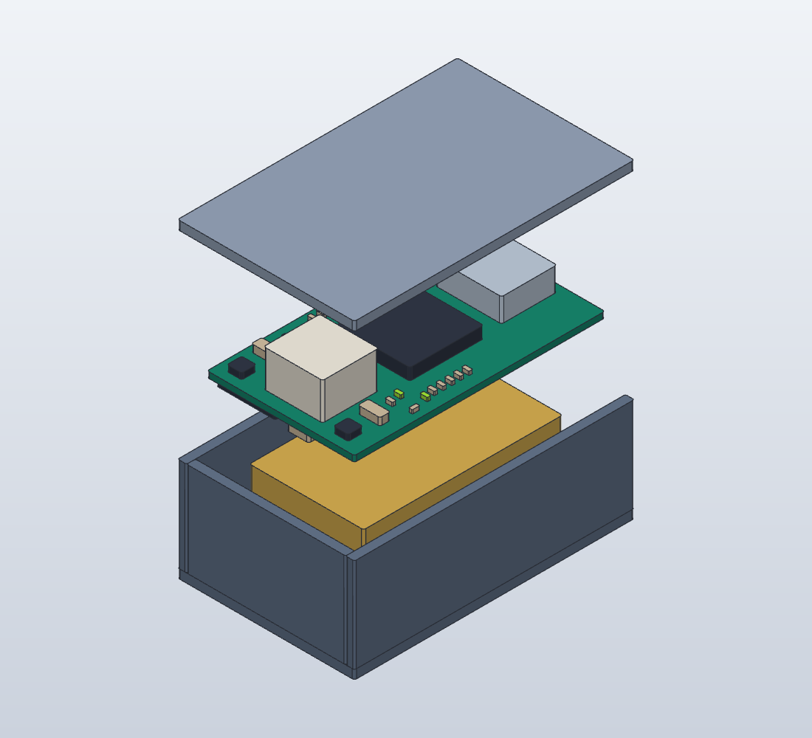

# Rev A1 内部構造モデル

> 厚さ上限15.0mmの追加指定により、この15.2mm案は採用しない。旧構造の説明用として保存。薄型配置は再設計が必要。

2026-10-24。**構造説明用。製造用筐体でも、干渉検証済みアセンブリでもない。**

[回転・分解できるビューア](viewer.html)をブラウザで開く。依存ライブラリや外部通信は不要。ドラッグで回転、スライダーで分解、ケース非表示、ホイールでズームできる。



下からケース底、既製電池、両面基板、蓋。現基板のplacement-report.jsonから部品の位置・面・回転を取得し、簡略化したボディを表示する。端子・はんだ・正確な部品外形は再現しない。テストパッドとSWDパッドは省略。特にPHコネクタ・USB・ICの高さは検討用仮値であり、メーカー3D原本ではない。

- 基板: 20×34×0.8mm、底面z=7.6mm。
- 電池: パック最大15.5×27×4.2mm、底面z=1.6mm。配線・PHプラグは別体で未モデル化。
- ケース枠: 24×38×15.2mm。壁・底・蓋は1.2mm。USB側端壁を省いた説明用形状。角の接合、固定、吊下げ、開口、公差、膨張余裕は未設計。
- 電池上面z=5.8mmから基板底面まで1.8mm。底面部品もこの空間に入る。電池配線100±3mm、コネクタ挿抜、NTC接触、電池と基板の固定は未解決。
- LED/ボタンは現PCBの自動配置位置のまま。筐体外から見える/押せるとは限らない。
- 分解表示は電池+7mm、基板と搭載部品+16mm、蓋+27mmを追加。実寸の厚さとは区別する。

`assembled.solidcraft` / `exploded.solidcraft`はSolidCraftで編集可能。対応するSTEPは交換用。`generate.py`が寸法・配置から再生成する。HTML内の部品データはstructure.jsonのコピーであり、再生成後は再埋込する。

```sh
python3 mechanical/structure-a1/generate.py
solidcraft-cli run mechanical/structure-a1/assembled.json --save mechanical/structure-a1/assembled.solidcraft --out mechanical/structure-a1/assembled.step --quiet
solidcraft-cli run mechanical/structure-a1/exploded.json --save mechanical/structure-a1/exploded.solidcraft --out mechanical/structure-a1/exploded.step --quiet
```

SolidCraftによる両モデル生成、STEP書出し、分解画像描画を確認。24時間録音や現回路の成立を検証するモデルではない。旧26mm円形モデルより現状の内部構造に近いが、最小外形の確定ではない。
