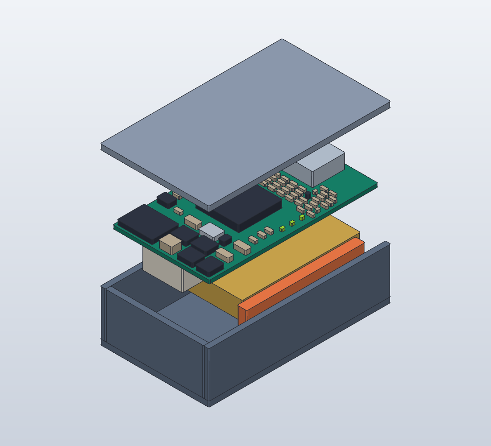
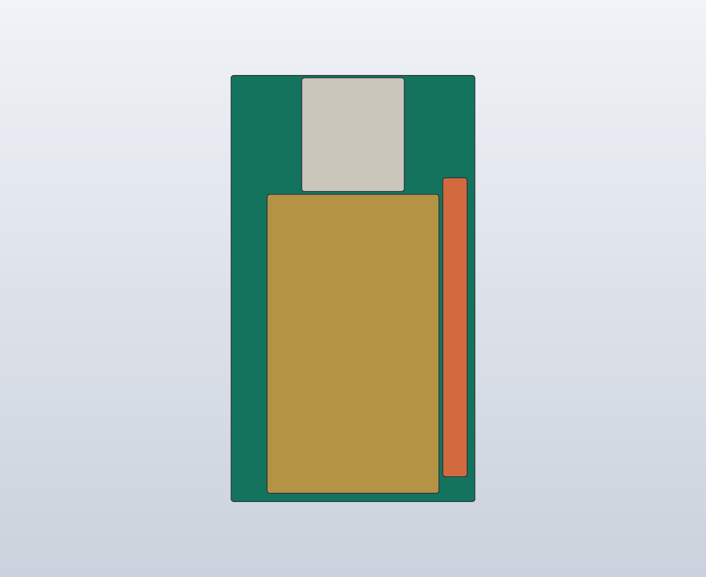

# A2 薄型構造の検討モデル

[回転・分解ビューア](viewer.html) / [SolidCraft組立モデル](assembled.solidcraft) / [STEP](assembled.step)

**構造比較用。A1回路・PCBを変更したものではなく、製造不可。** 92部品のうち90部品のフットプリント外接領域を表面へ再配置し、PH端子とNTCを裏面に置く機械配置案。配線・デカップリング・音響・ボタン/表示位置を満たした電気設計ではない。テストパッド/SWDは配置枠には含め、3D描画では省略。



## 変更

PH端子を基板の裏面・電池の端へ移す。高さ5mmの暫定領域を電池4.2mmと横に並べ、電池の上へ積み重ねない。電池直上の基板裏面から主要部品を除き、表面へ集める。MCUはLQFP64のままで、新パッケージが調達できると仮定して小さく見せていない。

| 比較 | 旧構造A1 | 今回のA2仮モデル |
|---|---:|---:|
| ケース外接寸法 | 24×38×15.2mm | 24.8×41.5×12.8mm |
| 基板 | 20×34×0.8mm | 22×38.5×0.8mm |
| 外接容積 | 13.86cm³ | 13.17cm³ |
| 厚さ | 上限超過 | 15mm上限より2.2mm小さい仮寸法 |

厚さ15.8%減、外接容積4.9%減。ただし平面面積は12.9%増。薄型化と小型化は同じではなく、幅・長さを最小化した案ではない。

## 中身と寸法予算



黄色は既製電池最大15.5×27×4.2mm、白はPH端子用の暫定領域、オレンジは配線収納の予約領域（2.2×27×4.2mm）。オレンジは実際の電線形状ではない。付属100±3mm配線、嵌合プラグ全体、曲げ半径、挿抜空間が収まるかは未確認。

- 底1.2mm、電池底z=1.5mm・上z=5.7mm。
- 基板底z=6.9mm・上z=7.7mm。電池上に1.2mmの空間。絶縁・膨張・固定・NTC接触をこの中で設計する必要がある。
- PH端子領域9.25×10.25×5mm、底z=1.9mm。平面はA1のフットプリント外接領域を採用。高さと嵌合形状はメーカー監査前。
- 表面最大高さはUSBの仮3.2mm、上端z=10.9mm。蓋下面z=11.6mm、余裕0.7mm。USBの製品3Dモデルとの照合が必要。
- 蓋1.2mm、総厚12.8mm。固定部・ボタン突出・吊下げは未設計なので完成厚さの保証ではない。
- NTCの接触候補位置は置いたが、セルまで0.4mmの接触部材と応答確認が必要。マイク音孔下の電池との干渉・音路、LED可視性、ボタン操作性は未解決。

A1のKiCadフットプリント外接寸法で90領域が重ならない配置を生成。これは部品本体・端子・はんだ・配線の完全な3D監査ではない。実装条件と配線で成立しなければ外形や配置を再変更する。

## 再生成

`footprint-bounds.json`はA1基板のKiCad外接領域。`generate.py`が配置と3種類のSolidCraftスクリプトを生成する。組立・分解モデルの保存、STEP書出し、分解/下面画像の描画を確認済み。

```sh
python3 mechanical/structure-a2/generate.py
solidcraft-cli run mechanical/structure-a2/assembled.json --save mechanical/structure-a2/assembled.solidcraft --out mechanical/structure-a2/assembled.step --quiet
solidcraft-cli run mechanical/structure-a2/exploded.json --save mechanical/structure-a2/exploded.solidcraft --out mechanical/structure-a2/exploded.step --quiet
```
