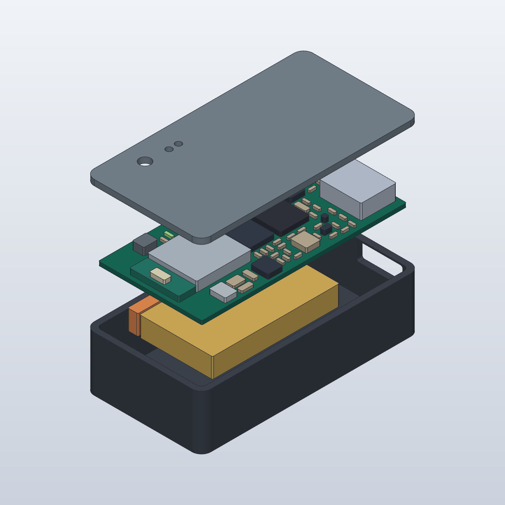

# Rev B0 — ケース・内部構造

**実物写真ではなくSolidCraftのCADレンダリング。製造/印刷リリース前の構造案。**

[外観](assembled.png) / [内部](interior.png) / [組立SolidCraft](assembled.solidcraft) / [分解SolidCraft](exploded.solidcraft) / [STEP](assembled.step)

ケース外形 **24.8×46.5×12.8mm**、PCB **22×43.5×0.8mm**。Rev Bの `placement-report.json` から部品位置を生成している。黄色は既製電池最大15.5×27×4.2mm、オレンジは未加工電池線の収納予約領域。金属色はモジュールのシールドとUSB-C。アンテナ領域をシールドと分けて図示したが、メーカーの精密3D形状ではない。

旧A2案24.8×41.5×12.8mmに対し、長さ+5mm・外接容積約+12%。アンテナ領域と電池/PH端子の分離を優先した仮配置。薄さは維持したが、最小化を完了したとは扱わない。

SolidCraftで底ケースの空洞、PCB受け、USB開口、蓋、表示窓/ボタンアクセス穴を作成。電池の上に基板を置き、PH端子は電池の端に並べる。主要部品高さには仮定を含む。モデルのPCB表現は厚さのある外形で、銅配線・全穴・全リードの精密形状は省略。

未完了：蓋の固定機構、装着用ストラップ/クリップ、底面マイクの音道とガスケット、NTC接触材、嵌合プラグと100mmリードの実収納、材料/印刷公差・強度検証。これらがない状態のケースを完成品として注文しない。

`generate.py` → `solidcraft-cli run <mode>.json --save <mode>.solidcraft --out <mode>.step --quiet` → `solidcraft-cli snapshot ...` で再生成。modeはassembled/exploded/interior。
